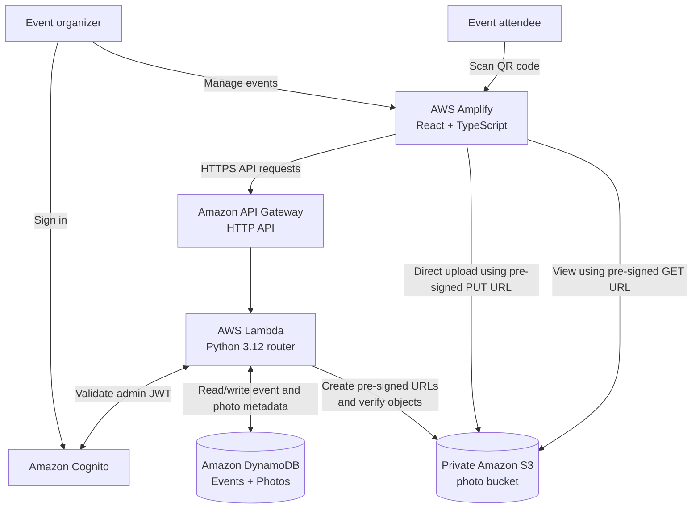

[README.md](https://github.com/user-attachments/files/34874097/README.md)
# EventSnap 📸

**One event. One QR code. Everyone's memories.**

EventSnap is a multi-event photo-sharing platform. Organizers create events and share a QR code; attendees scan it, open the event page, upload photos, and browse the shared gallery.

<p align="center">
  <a href="https://main.d2pw46kgpwxeu6.amplifyapp.com/"><strong>🌐 Live Demo</strong></a> ·
  <a href="https://main.d2pw46kgpwxeu6.amplifyapp.com/admin/login"><strong>Admin Portal</strong></a> ·
  <a href="https://main.d2pw46kgpwxeu6.amplifyapp.com/events/evt_acf11632ad"><strong>Sample Event</strong></a>
</p>

---

## ✨ What can you do with EventSnap?

### For organizers
- Sign in through Amazon Cognito.
- Create and manage multiple events.
- Update event details and event status.
- Generate a QR code for each event.
- View event galleries and manage uploaded photos.

### For attendees
- Scan an event QR code and open its public page.
- Upload photos from a phone or computer without creating an admin account.
- Browse the event gallery.

### Platform capabilities
- Direct browser-to-S3 uploads using time-limited pre-signed URLs.
- Private image storage with S3 Block Public Access and server-side encryption.
- Event and photo metadata stored in DynamoDB.
- Serverless API built with API Gateway and Lambda.

## 🧭 How it works

1. An organizer signs in and creates an event.
2. EventSnap creates an event page and QR code.
3. Attendees scan the QR code to open the public event page.
4. The frontend requests a pre-signed upload URL from the backend.
5. The browser uploads the image directly to the private S3 bucket.
6. The frontend asks the backend to confirm the upload.
7. The backend verifies the S3 object and saves photo metadata in DynamoDB.
8. The gallery loads photo metadata and temporary pre-signed download URLs.

## 🏗️ Architecture

The React frontend is hosted on AWS Amplify. It calls an API Gateway HTTP API, which invokes a Python Lambda function. Lambda uses Cognito to validate organizer access, DynamoDB to store metadata, and S3 to store image files.



### AWS services

| Service | What it does |
|---|---|
| AWS Amplify Hosting | Hosts the public React frontend over HTTPS |
| Amazon API Gateway HTTP API | Provides the backend HTTPS API |
| AWS Lambda | Runs the Python backend |
| Amazon S3 | Stores uploaded photo files |
| Amazon DynamoDB | Stores event records and photo metadata |
| Amazon Cognito | Authenticates organizers/admins |
| AWS SAM / CloudFormation | Defines and deploys backend infrastructure |
| Amazon CloudWatch | Collects Lambda logs and operational information |
| AWS X-Ray | Tracing is enabled for the Lambda function |

**Deployed AWS region:** Asia Pacific (Sydney), `ap-southeast-2`.

## 🧰 Technology stack

| Layer | Technologies |
|---|---|
| Frontend | React 18, TypeScript, Vite |
| Routing | React Router |
| Styling | Tailwind CSS |
| Icons | Lucide React |
| QR code generation | `qrcode` |
| Backend | Python 3.12, AWS Lambda |
| API | Amazon API Gateway HTTP API |
| Authentication | Amazon Cognito, JWT |
| Object storage | Amazon S3 |
| Database | Amazon DynamoDB |
| Infrastructure as Code | AWS SAM, CloudFormation |
| Hosting | AWS Amplify |

## 📂 Project structure

```text
EventSnap/
├── frontend/
│   ├── public/                 # Static public assets
│   ├── src/                    # React application source
│   ├── package.json            # Frontend dependencies and scripts
│   └── .env.example            # Example frontend configuration
├── backend/
│   ├── src/
│   │   ├── handlers/           # Event and photo request handlers
│   │   ├── services/           # AWS and application services
│   │   ├── utils/              # Shared helpers and validation
│   │   ├── config.py           # Backend configuration
│   │   └── router.py           # Lambda request router
│   └── infrastructure/
│       ├── template.yaml       # AWS SAM / CloudFormation template
│       └── setup_aws.py        # AWS setup utility
├── .gitignore
└── README.md
```

## 🚀 Run the frontend locally

### Prerequisites
- Git
- Node.js and npm

### 1. Clone the repository

```bash
git clone https://github.com/Vaishnavi74-star/EventSnap.git
cd EventSnap
```

### 2. Install frontend dependencies

```bash
cd frontend
npm install
```

If a `package-lock.json` is present, `npm ci` can be used for a reproducible install.

### 3. Configure environment variables

Create `frontend/.env` using `frontend/.env.example` as a guide. Set the API endpoint and Cognito identifiers for the environment you intend to use.

```env
VITE_API_BASE_URL=
VITE_USE_REAL_BACKEND=true
VITE_AWS_REGION=ap-southeast-2
VITE_COGNITO_USER_POOL_ID=
VITE_COGNITO_CLIENT_ID=
```

Use the actual values from your own AWS deployment. **Never put AWS access keys, secret keys, passwords, private credentials, or server-side secrets in `VITE_*` variables.** Vite variables are included in browser-accessible frontend code.

### 4. Start the development server

```bash
npm run dev
```

Vite normally serves the frontend at `http://localhost:5173`. Starting the frontend does not start the cloud backend; configure it to use a reachable API.

### 5. Build for production

```bash
npm run build
```

The production frontend is generated in `frontend/dist/`.

## ☁️ Backend infrastructure and deployment

The backend infrastructure is described in `backend/infrastructure/template.yaml`. The deployed environment described here uses AWS region `ap-southeast-2`.

### Prerequisites
- An AWS account with permissions for the resources in the SAM template.
- AWS CLI v2.
- AWS SAM CLI.
- Python 3.12-compatible Lambda dependencies.
- An authenticated AWS CLI profile.

### Validate and build

From the repository root:

```bash
sam validate --template-file backend/infrastructure/template.yaml --region ap-southeast-2
sam build --template-file backend/infrastructure/template.yaml
```

The existing deployed stack is named `eventsnap-production`. **If you are working in the original AWS account, inspect the existing CloudFormation stack and its change set before deploying anything.** Do not blindly create another stack or replace existing resources.

The SAM template defines:
- A private S3 bucket, named using the deployment stage and AWS account ID.
- Two on-demand DynamoDB tables for events and photos.
- A Cognito user pool and browser app client.
- An API Gateway HTTP API.
- A Python 3.12 Lambda function and its execution role.
- CloudFormation outputs for the API endpoint, bucket, table names and Cognito IDs.

The current template sets DynamoDB point-in-time recovery to disabled. Review backup and recovery requirements before using the system for important event data.

## 🔐 Security and privacy

- The S3 bucket is configured with S3 Block Public Access and AES-256 default encryption.
- Images are accessed through temporary pre-signed URLs rather than public bucket URLs.
- Pre-signed upload URL lifetime: **15 minutes**.
- Pre-signed download URL lifetime: **1 hour**.
- The template's default maximum upload size is **25 MiB**, configurable through `MaxFileSizeBytes`.
- Public attendee event and gallery routes are designed to work without organizer login; organizer management routes require Cognito JWT authentication.
- Rotate any temporary or default admin password before sharing the application.
- Never commit `.env` files, AWS credentials, passwords, tokens, private keys, or real attendee photos.
- Review CORS settings before production use. Allow only the frontend origins you control; avoid wildcard origins in production.
- Define appropriate retention, backup, moderation, monitoring and access policies before using EventSnap for sensitive or high-value events.

## 🧪 Deployment verification checklist

Use this checklist after deploying or changing the application:

- [ ] Public website loads over HTTPS.
- [ ] Organizer/admin can sign in through Cognito.
- [ ] Admin can create an event.
- [ ] Event QR code opens the public event page, not a localhost URL.
- [ ] Attendee can request a pre-signed upload URL without admin login.
- [ ] Image uploads directly to S3.
- [ ] Upload confirmation stores photo metadata in DynamoDB.
- [ ] Gallery displays the image using a temporary download URL.
- [ ] Admin-only operations reject unauthenticated requests.
- [ ] Production browser requests do not point to localhost.

## 💰 AWS cost awareness

Serverless does **not** mean automatically free. Charges depend on requests, storage, data transfer, logs, backups, region-specific prices and account eligibility for Free Tier benefits or promotional credits.

- Check the [AWS Billing Console](https://console.aws.amazon.com/billing/home) regularly.
- Use the [AWS Pricing Calculator](https://calculator.aws/) to estimate usage.
- Configure AWS Budget alerts. Alerts notify you; they do not automatically stop spending.
- Monitor S3 storage and requests, API calls, Lambda invocations/duration, DynamoDB usage, CloudWatch logs and Amplify build/hosting usage.

## 🌍 Live deployment

| Resource | Link |
|---|---|
| Public website | [EventSnap](https://main.d2pw46kgpwxeu6.amplifyapp.com/) |
| Admin portal | [Admin login](https://main.d2pw46kgpwxeu6.amplifyapp.com/admin/login) |
| Sample event | [Open sample gallery](https://main.d2pw46kgpwxeu6.amplifyapp.com/events/evt_acf11632ad) |
| GitHub repository | [Vaishnavi74-star/EventSnap](https://github.com/Vaishnavi74-star/EventSnap) |

## 🤝 Contributing

Suggestions, bug reports and contributions are welcome.

1. Fork the repository.
2. Create a feature branch: `git checkout -b feature/your-feature`.
3. Make and test your changes.
4. Commit: `git commit -m "Add: describe your change"`.
5. Push your branch and open a Pull Request.

Do not include credentials, production environment files, private keys or real attendee photos in commits or pull requests.

## 📄 License

No license is currently specified. Unless a license is added to this repository, the default copyright restrictions apply. Contact the repository owner before reusing, modifying or redistributing this project.

---

<p align="center">
  Built to make sharing event memories simple. 📸<br/>
  <strong>EventSnap — One event. One QR code. Everyone's memories.</strong>
</p>
