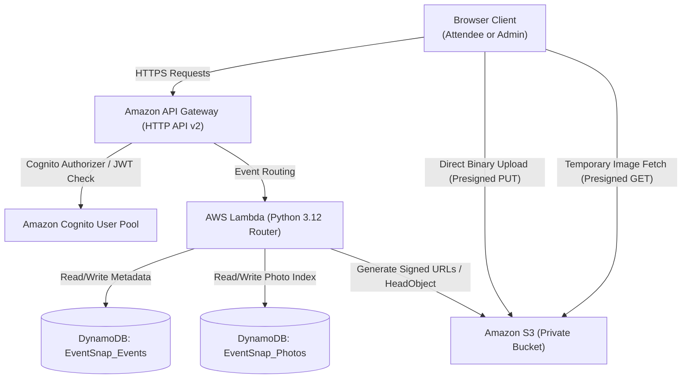

# EventSnap — AWS Serverless Backend Architecture & Guide

EventSnap's backend is a production-grade, 100% serverless infrastructure powered by **Python 3.12, AWS Lambda, Amazon API Gateway HTTP API, Amazon S3, Amazon DynamoDB, and Amazon Cognito**.

---

## 🏗️ 1. Architecture Overview



### Key Guarantees
* **Zero-Binary Lambda:** The Lambda handler **never receives image binaries**, preventing memory bottlenecks, execution timeouts, and unnecessary cloud billing.
* **100% Private S3:** Bucket blocks all public ACLs and public policies. Image access is mediated strictly via temporary signed URLs.
* **Atomic Consistency:** Upload confirmation verifies object presence in S3 using `head_object` before saving metadata to DynamoDB and incrementing the event's `photoCount`.

---

## 📡 2. API Endpoint Documentation

Base path: `/api/v1` or `/` (API Gateway `$default` stage)

### Event Management APIs
| Method | Path | Auth | Description | Request Body |
| :--- | :--- | :--- | :--- | :--- |
| `POST` | `/events` | Admin (JWT) | Create a new event with auto-generated `eventId` | `{"name": "Summit", "date": "2026-11-20T09:00:00Z", "location": "SF", "description": "...", "coverImageUrl": "..."}` |
| `GET` | `/events` | Admin (JWT) | List all events managed by the admin | Query: `status` (`ACTIVE`/`CLOSED`/`ARCHIVED`), `limit`, `nextToken` |
| `GET` | `/events/{eventId}` | Public / Admin | Get event metadata & settings | None |
| `PUT` | `/events/{eventId}` | Admin (JWT) | Update mutable event details | `{"name", "description", "date", "location", "coverImageUrl"}` |
| `PATCH`| `/events/{eventId}/status` | Admin (JWT) | Change status (`ACTIVE`, `CLOSED`, `ARCHIVED`) | `{"status": "ACTIVE" \| "CLOSED" \| "ARCHIVED"}` |
| `DELETE`| `/events/{eventId}` | Admin (JWT) | Safely archives the event (`status = ARCHIVED`) | None |
| `GET` | `/events/{eventId}/analytics` | Admin (JWT) | Aggregate metrics, storage size, and upload activity | None |

### Photo Upload & Gallery APIs
| Method | Path | Auth | Description | Request Body |
| :--- | :--- | :--- | :--- | :--- |
| `POST` | `/events/{eventId}/upload-url` | Public / Attendee | Verifies event is active and returns a Presigned S3 PUT URL | `{"fileName": "photo.jpg", "contentType": "image/jpeg", "fileSize": 3145728}` |
| `POST` | `/events/{eventId}/photos/confirm` | Public / Attendee | Verifies S3 object exists via `head_object` and indexes in DynamoDB | `{"photoId": "pht_...", "s3Key": "events/.../photos/pht_....jpg", "fileName": "photo.jpg", "contentType": "image/jpeg"}` |
| `GET` | `/events/{eventId}/photos` | Public / Attendee | Lists approved photos with temporary Presigned GET URLs | Query: `limit`, `nextToken` |
| `DELETE`| `/events/{eventId}/photos/{photoId}` | Admin (JWT) | Permanently deletes photo from S3 and removes metadata | None |

---

## 🗄️ 3. DynamoDB Table Definitions

### Table 1: `EventSnap_Events`
* **Billing Mode:** On-Demand (`PAY_PER_REQUEST`)
* **Partition Key (PK):** `eventId` (String, e.g. `evt_a1b2c3d4e5`)
* **Global Secondary Index (GSI):** `organizerId-createdAt-index`
  * Partition Key: `organizerId` (String)
  * Sort Key: `createdAt` (String, ISO 8601 UTC)
  * Projection: `ALL`
* **Attributes:**
  * `eventId`: Unique event identifier
  * `name`: Event title
  * `description`: Event description
  * `date`: Event date/time (ISO 8601 UTC)
  * `location`: Venue or location name
  * `coverImageUrl`: Banner image URL or S3 key
  * `status`: `ACTIVE`, `CLOSED`, or `ARCHIVED`
  * `organizerId`: Cognito `sub` of the creator
  * `photoCount`: Atomic counter of uploaded photos
  * `createdAt`: ISO 8601 UTC
  * `updatedAt`: ISO 8601 UTC
  * `archivedAt`: ISO 8601 UTC (if archived)

### Table 2: `EventSnap_Photos`
* **Billing Mode:** On-Demand (`PAY_PER_REQUEST`)
* **Partition Key (PK):** `eventId` (String)
* **Sort Key (SK):** `photoId` (String, e.g. `pht_10a7b4c29012`)
* **Global Secondary Index (GSI):** `EventPhotosByDate`
  * Partition Key: `eventId` (String)
  * Sort Key: `uploadedAt` (String, ISO 8601 UTC)
  * Projection: `ALL`
* **Attributes:**
  * `eventId`: Event partition key
  * `photoId`: Unique photo identifier
  * `s3Key`: Full S3 key (`events/{eventId}/photos/{photoId}.jpg`)
  * `fileName`: Original file name
  * `contentType`: MIME type (e.g. `image/jpeg`, `image/png`, `image/webp`)
  * `fileSize`: Exact byte length verified from S3 HeadObject
  * `status`: `APPROVED`, `FLAGGED`, or `DELETED`
  * `uploadedAt`: ISO 8601 UTC
  * `uploadedBy`: `attendee` or `admin`

---

## 🪣 4. Amazon S3 Bucket Configuration

* **Bucket Name:** `eventsnap-photos-{stage}-{accountId}`
* **Default Encryption:** SSE-S3 (`AES256`)
* **Block Public Access:** **100% ENABLED**
  ```json
  {
    "BlockPublicAcls": true,
    "IgnorePublicAcls": true,
    "BlockPublicPolicy": true,
    "RestrictPublicBuckets": true
  }
  ```
* **CORS Configuration:**
  ```json
  [
    {
      "AllowedHeaders": ["*"],
      "AllowedMethods": ["GET", "PUT", "HEAD"],
      "AllowedOrigins": ["*"],
      "ExposeHeaders": ["ETag"],
      "MaxAgeSeconds": 3600
    }
  ]
  ```
* **Object Structure:**
  ```
  s3://eventsnap-photos-prod-123456789012/
  └── events/
      └── {eventId}/
          └── photos/
              ├── pht_abc123.jpg
              └── pht_xyz789.png
  ```

---

## 🛡️ 5. IAM Least-Privilege Policy for Lambda

Attach this policy to the Lambda execution role:

```json
{
  "Version": "2012-10-17",
  "Statement": [
    {
      "Sid": "DynamoDBTableAccess",
      "Effect": "Allow",
      "Action": [
        "dynamodb:GetItem",
        "dynamodb:PutItem",
        "dynamodb:UpdateItem",
        "dynamodb:DeleteItem",
        "dynamodb:Query",
        "dynamodb:Scan"
      ],
      "Resource": [
        "arn:aws:dynamodb:*:*:table/EventSnap_Events*",
        "arn:aws:dynamodb:*:*:table/EventSnap_Events*/index/*",
        "arn:aws:dynamodb:*:*:table/EventSnap_Photos*",
        "arn:aws:dynamodb:*:*:table/EventSnap_Photos*/index/*"
      ]
    },
    {
      "Sid": "S3ObjectManagement",
      "Effect": "Allow",
      "Action": [
        "s3:PutObject",
        "s3:GetObject",
        "s3:DeleteObject",
        "s3:HeadObject"
      ],
      "Resource": "arn:aws:s3:::eventsnap-photos-*/*"
    },
    {
      "Sid": "CloudWatchLogs",
      "Effect": "Allow",
      "Action": [
        "logs:CreateLogGroup",
        "logs:CreateLogStream",
        "logs:PutLogEvents"
      ],
      "Resource": "arn:aws:logs:*:*:*"
    }
  ]
}
```

---

## 🔐 6. Amazon Cognito Setup

1. **User Pool Creation:**
   * User Pool Name: `eventsnap-admins-prod`
   * Sign-in identifier: **Email address**
   * Password policy: 8 characters minimum, uppercase, lowercase, numbers
2. **App Client:**
   * Client Name: `eventsnap-web-client`
   * Generate client secret: **No** (Single-Page App)
   * Auth flows: `ALLOW_USER_PASSWORD_AUTH`, `ALLOW_REFRESH_TOKEN_AUTH`
3. **API Gateway Authorizer:**
   * Create an HTTP API JWT Authorizer pointing to the User Pool Issuer URL:
     `https://cognito-idp.{region}.amazonaws.com/{userPoolId}`
   * Audience: Your App Client ID.

---

## 💻 7. Local Testing & Verification

### Run Automated Unit Tests
```bash
python -m pytest backend/tests -v
```

### Run the Local Lambda Server
```bash
python backend/local_runner.py
```
This starts an HTTP server on `http://localhost:8000` executing the real Lambda handlers with CORS enabled.

### Switch Frontend to Real Backend
In `frontend/.env`, toggle:
```ini
VITE_API_BASE_URL=http://localhost:8000
VITE_USE_REAL_BACKEND=true
```

### Automated Cloud Provisioning via Script
If deploying directly using AWS credentials:
```bash
python backend/infrastructure/setup_aws.py
```

### Deploying via AWS SAM CLI
```bash
cd backend/infrastructure
sam build
sam deploy --guided
```

